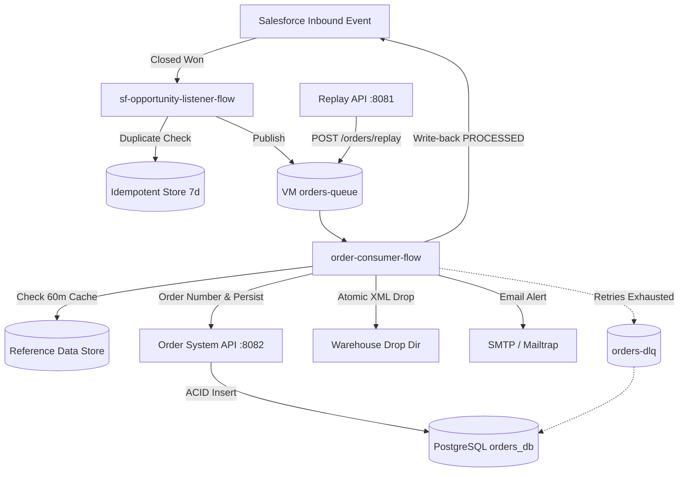

# Salesforce Closed-Won Opportunity to Order Fulfilment Integration

Production-grade event-driven, API-led MuleSoft integration for capturing Salesforce Closed-Won Opportunities, persisting orders to a PostgreSQL fulfilment database, dropping atomic warehouse XML files, notifying the fulfilment desk via email, updating Salesforce, and exposing a Replay API.

---

## 1. Architecture Overview

The repository consists of two decoupled MuleSoft applications:

1. **`sf-listener`** (Root Project):
   - **Salesforce Inbound Listener:** Captures Closed-Won opportunities, enforces 7-day idempotency via Object Store, and publishes lightweight events to a persistent VM queue (`orders-queue`).
   - **Asynchronous Consumer:** Consumes from the VM queue, queries/enriches data with a 60-minute reference data cache, verifies line amount tolerance (`0.01`), requests sequence order numbers, persists via System API, drops atomic `.tmp` -> `.xml` warehouse files, updates Salesforce (`PROCESSED`), and sends email notifications.
   - **Replay API & RAML Router:** Exposes `POST /api/orders/replay` (with idempotency and `force` override) and `GET /api/orders/{orderNumber}` on port `8081`.
   - **Resilience & DLQ:** Retries transient failures up to 3 times with exponential backoff; routes poison messages to `orders-dlq` and logs structured records in `order_exception`.

2. **`order-system-api`** (Sub-project in `order-system-api/`):
   - Standalone System API on port `8082` providing atomic transactions over the PostgreSQL database `orders_db`.
   - Generates ERP sequence numbers (`ERP-<yyyy>-<sequence>`) and enforces header/line integrity with unique constraints (`uq_order_opportunity`).



---

## 2. Port Allocation

| Component | Port | Description |
| :--- | :---: | :--- |
| **`sf-listener` (Process/Experience API)** | `8081` | Order Replay API (`/api/orders/replay`, `/api/orders/{orderNumber}`) |
| **`order-system-api` (System API)** | `8082` | Order Persistence & Sequence API (`/api/orders`, `/api/order-numbers`) |
| **PostgreSQL Database** | `5432` | Fulfilment database (`orders_db`) |

---

## 3. Prerequisites

* **Java JDK:** **JDK 17** (e.g., Eclipse Adoptium `jdk-17.0.20.8-hotspot` or Temurin 17).  
  *⚠️ Note:* Do NOT use Java 21 or Java 8. Mule 4.12 runtime extensions reject Java 21.
* **Apache Maven:** 3.8+ or Anypoint Studio 7.15+ (Mule Runtime 4.4 / 4.12 EE).
* **PostgreSQL:** Version 12+ running locally or in Docker.
* **Git:** For version control.

---

## 4. Step-by-Step Setup Guide

### Step 4.1: Database Initialization
1. Ensure PostgreSQL is running on `localhost:5432`.
2. Create the `orders_db` database if it does not already exist:
   ```sql
   CREATE DATABASE orders_db;
   ```
3. Run the schema script located at `sql/init_database.sql`:
   ```bash
   # Using psql:
   psql -U postgres -h localhost -p 5432 -d orders_db -f sql/init_database.sql
   ```
   This script creates:
   - Sequence: `order_number_seq`
   - Tables: `sales_order`, `sales_order_line`, `order_exception`
   - Unique constraints and performance indexes.

---

### Step 4.2: Configuration & Secure Properties Setup

Both applications use externalized property files that are gitignored for safety.

#### 1. System API Configuration (`order-system-api`)
Copy the template file to `local.properties`:
```bash
# Windows PowerShell:
Copy-Item order-system-api/src/main/resources/local.properties.example order-system-api/src/main/resources/local.properties

# Linux / macOS Bash:
cp order-system-api/src/main/resources/local.properties.example order-system-api/src/main/resources/local.properties
```
*Edit `order-system-api/src/main/resources/local.properties` with your PostgreSQL password (`db.password`).*

#### 2. Main Application Configuration (`sf-listener`)
Copy the local properties template:
```bash
# Windows PowerShell:
Copy-Item src/main/resources/local.properties.example src/main/resources/local.properties

# Linux / macOS Bash:
cp src/main/resources/local.properties.example src/main/resources/local.properties
```

Copy the secure properties template:
```bash
# Windows PowerShell:
Copy-Item src/main/resources/secure.properties.example src/main/resources/secure.properties

# Linux / macOS Bash:
cp src/main/resources/secure.properties.example src/main/resources/secure.properties
```

The template `secure.properties.example` comes pre-populated with dummy placeholders encrypted with the test key:
`MyHackKey2026abc`. This allows **all MUnit tests to run immediately** without live credentials.

---

### Step 4.3: Secure Key Generation & Encryption Guide

The project uses Mule's Secure Configuration Properties module with **Blowfish / CBC / PKCS5Padding** and random IVs (`useRandomIVs="true"`).

When using live credentials, encrypt each value using the Mule Secure Properties Tool:
```bash
java -cp secure-properties-tool.jar com.mulesoft.tools.SecurePropertiesTool \
  string \
  encrypt \
  Blowfish \
  CBC \
  <YOUR_SECURE_KEY> \
  "<PLAINTEXT_VALUE>"
```
Wrap the output in `![...]` in `src/main/resources/secure.properties`:
```ini
db.password=![<encrypted_db_password>]
sf.password=![<encrypted_sf_password>]
sf.token=![<encrypted_sf_security_token>]
smtp.password=![<encrypted_smtp_password>]
```

---

## 5. Running MUnit Test Suites

Both applications have 100% passing automated MUnit test suites (23/23 tests green).

### Environment Variables
Set the encryption key and JDK 17 in your shell:

#### Windows PowerShell:
```powershell
$env:JAVA_HOME = "C:\Program Files\Eclipse Adoptium\jdk-17.0.20.8-hotspot"
$env:Path = "$env:JAVA_HOME\bin;" + $env:Path
$env:SECURE_KEY = "MyHackKey2026abc"
```

#### Linux / macOS:
```bash
export JAVA_HOME="/usr/lib/jvm/temurin-17-jdk"
export PATH="$JAVA_HOME/bin:$PATH"
export SECURE_KEY="MyHackKey2026abc"
```

---

### Running Tests for `order-system-api` (7 Tests)
```bash
cd order-system-api
mvn clean test
```
*Expected Result:* **BUILD SUCCESS**, 7 Tests, 0 Errors, 0 Failures (Coverage: 67.31%).

---

### Running Tests for `sf-listener` (16 Tests)
```bash
cd ..
mvn clean test
```
*Expected Result:* **BUILD SUCCESS**, 16 Tests, 0 Errors, 0 Failures (Coverage: 58.44%).
* Suites tested:
  - `order-replay-api-test.xml` (6 tests: force replay, duplicate skipping, GET order details)
  - `retry-attempt-flow-test.xml` (4 tests: transient retries, permanent classifications, auth failures)
  - `order-consumer-flow-test.xml` (6 tests: happy path, amount mismatch, missing reference data, retry exhaustion, DLQ forwarding, invalid payload)

**Total Workspace Test Baseline: 23 / 23 Tests PASSING.**

---

## 6. Running Applications Locally

To run both services side-by-side locally:

### 1. Start `order-system-api` (Port 8082)
```bash
cd order-system-api
mvn mule:run
```
Console verification:
`http://localhost:8082/console/`

### 2. Start `sf-listener` (Port 8081)
```bash
cd sf-listener
mvn mule:run -Dsecure.key=$SECURE_KEY
```
Console verification:
`http://localhost:8081/console/`

---

## 7. API Verification & Testing Endpoints

### 1. Trigger Replay API (`POST /api/orders/replay`)
```bash
curl -X POST http://localhost:8081/api/orders/replay \
  -H "Content-Type: application/json" \
  -d '{
    "opportunityId": "006gK00000PpiQPQAZ",
    "force": true
  }'
```
Response:
```json
{
  "correlationId": "3fa6b2d1-8c47-4e90-b1a5-77e2c4f0d913",
  "opportunityId": "006gK00000PpiQPQAZ",
  "result": "REPUBLISHED",
  "message": "Event re-published to orders-queue"
}
```

### 2. Check Order Status (`GET /api/orders/{orderNumber}`)
```bash
curl http://localhost:8081/api/orders/ERP-2026-000041
```

---

## 8. Common Troubleshooting

| Issue | Root Cause | Solution |
| :--- | :--- | :--- |
| **`Supported versions are: [1.8, 11, 17]`** | Java 21 is set in your environment. | Point `JAVA_HOME` to JDK 17 (`Eclipse Adoptium 17`). |
| **`Couldn't find configuration property value for key ${secure.key}`** | Encryption key not passed to MUnit. | Set environment variable `SECURE_KEY=MyHackKey2026abc` or pass `-Dsecure.key=...`. |
| **`Exception resolving param 'entryTtl' with value '${ref.cache.ttl.minutes:60}'`** | Mule does not support fallback syntax in XML config attributes. | Ensure `ref.cache.ttl.minutes=60` is defined in `local.properties`. |
| **`NullPointerException` on `definitionRepository.createQueues()`** | Global `<configuration defaultErrorHandler-ref>` altered Spring bean startup order. | Keep flow-level error handlers; top-level default handler tag was removed in hardening. |
| **PostgreSQL `Connection refused: connect`** | PostgreSQL is not running or bad port. | Verify PostgreSQL service is active on port 5432 and `db.password` in `local.properties` is correct. |

---

## 9. Git & Security Protocol

- Never commit `local.properties` or `secure.properties`.
- Only commit `.example` template files with placeholder values.
- Verify `git status` before pushing:
  ```bash
  git status
  ```
