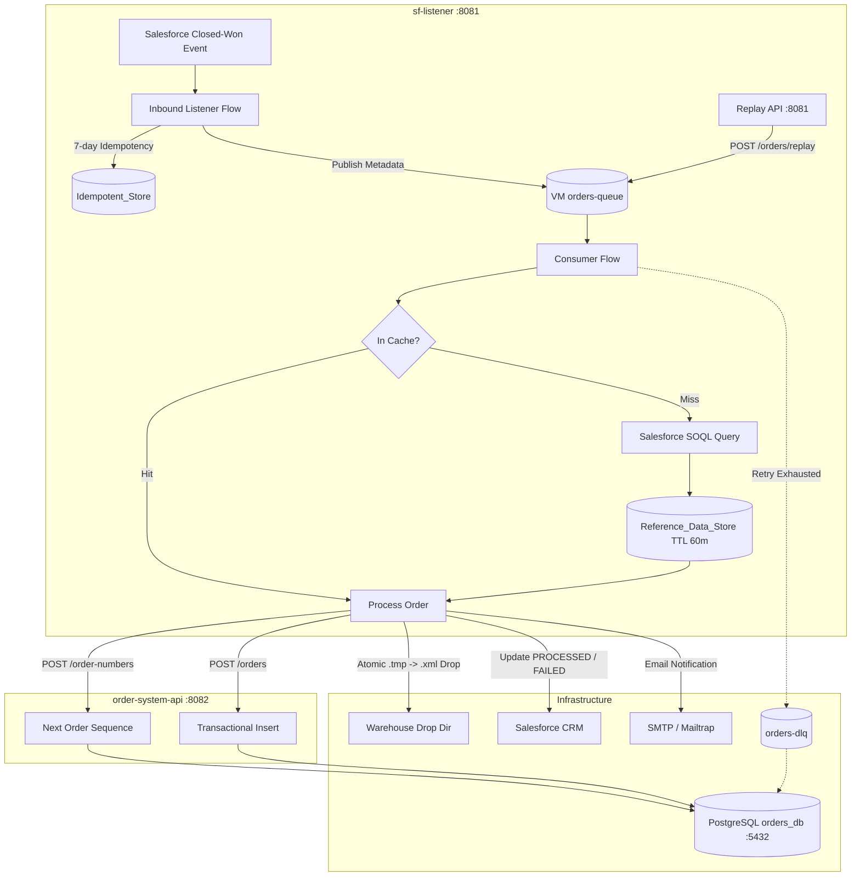

# Comprehensive Windows Local Setup & Developer Guide

**Project:** Salesforce Closed-Won Opportunity to Order Fulfilment Integration  
**Repository:** `anirvamn/mulesoft-salesforce-integration`  
**Branch:** `feature/order-fulfilment-hardening`  
**Target Environment:** Windows 10 / 11 (PowerShell 5.1+ or PowerShell Core 7+)  

---

## Table of Contents

1. [Understanding the Three Execution Modes](#1-understanding-the-three-execution-modes)
2. [Architecture Overview & Port Allocation](#2-architecture-overview--port-allocation)
3. [Prerequisites & Software Version Verification](#3-prerequisites--software-version-verification)
4. [Step 1: Clone the Repository & Check Out Branch](#4-step-1-clone-the-repository--check-out-branch)
5. [Step 2: PostgreSQL Database & Schema Setup](#5-step-2-postgresql-database--schema-setup)
6. [Step 3: Safe Configuration & Property Files Setup](#6-step-3-safe-configuration--property-files-setup)
7. [Step 4: Encryption Key Generation & Credential Encryption](#7-step-4-encryption-key-generation--credential-encryption)
8. [Step 5: Run Automated MUnit Tests (Mode 1: Zero External Dependencies)](#8-step-5-run-automated-munit-tests-mode-1-zero-external-dependencies)
9. [Step 6: Run Applications Locally (Mode 2: Local PostgreSQL + HTTP APIs)](#9-step-6-run-applications-locally-mode-2-local-postgresql--http-apis)
10. [Step 7: Verification & API Testing Endpoints](#10-step-7-verification--api-testing-endpoints)
11. [Mode 3: Live Salesforce, SMTP, CloudHub & API Manager Requirements](#11-mode-3-live-salesforce-smtp-cloudhub--api-manager-requirements)
12. [Occupied Ports & Port Conflict Resolution](#12-occupied-ports--port-conflict-resolution)
13. [Troubleshooting & Common Startup Failures](#13-troubleshooting--common-startup-failures)

---

## 1. Understanding the Three Execution Modes

Before starting, understand the three ways this project can be run. This prevents confusing local testing with cloud requirements:

| Execution Mode | What Runs | Prerequisites Needed | Purpose |
| :--- | :--- | :--- | :--- |
| **Mode 1: Automated Unit Testing (MUnit)** | 23 MUnit tests across both applications. All external systems (Salesforce, Database, SMTP, Files) are **100% mocked**. | • JDK 17<br>• Maven<br>• Test key `MyHackKey2026abc` | **Immediate verification.** Runs offline in ~3 minutes without PostgreSQL, Salesforce, or internet. |
| **Mode 2: Local Application Execution** | `order-system-api` (port 8082) and `sf-listener` (port 8081) running on your PC. | • JDK 17<br>• Local PostgreSQL (`orders_db`)<br>• Your local DB password | **Local development & API verification.** Test Replay API, Order Status API, DB persistence, and warehouse file generation. |
| **Mode 3: Live Enterprise Integration** | Full pipeline listening to live Salesforce Opportunity updates and sending real emails. | • Active Salesforce Developer Org<br>• Mailtrap SMTP account<br>• Optional: Anypoint Platform for CloudHub | **End-to-end cloud integration.** Connects to live third-party services. |

---

## 2. Architecture Overview & Port Allocation

The integration is implemented as a 2-tier API-led solution:



### Port Allocation

| Component | Port | Config Property | Defined In | Description |
| :--- | :---: | :--- | :--- | :--- |
| **`sf-listener`** | `8081` | Static port in listener | `src/main/mule/order-api.xml` | Replay API (`/api/orders/replay`), Status API (`/api/orders/{id}`), Console (`/console/*`) |
| **`order-system-api`** | `8082` | `${http.port}` | `order-system-api/src/main/resources/local.properties` | System API persistence & sequence numbers (`/console/*`) |
| **PostgreSQL Database** | `5432` | `${db.port}` | Both `local.properties` files | Relational database (`orders_db`) |

---

## 3. Prerequisites & Software Version Verification

Execute these verification commands in **Windows PowerShell**:

```powershell
# 1. Verify Git
git --version
# Expected: git version 2.35+ or higher

# 2. Verify Java (MUST be Java 17)
java -version
# Expected: openjdk version "17.0.x" ...

# 3. Verify Maven
mvn -version
# Expected: Apache Maven 3.8.x or 3.9.x

# 4. Verify PostgreSQL CLI
psql --version
# Expected: psql (PostgreSQL) 12.x - 16.x
```

### Critical Software Requirements & Warnings

* **Java JDK:** **Java SE 17 is strictly required** (e.g., Eclipse Adoptium `jdk-17.0.20+` or Temurin 17).  
  > [!CAUTION]
  > **DO NOT USE Java 21 or Java 8.** Mule 4.12 runtime extensions (including `ObjectStore` and `Secure Properties`) explicitly reject Java 21 (`Supported versions are: [1.8, 11, 17]`).
* **PATH Configuration on Windows:**
  * If `java -version` returns Java 21 or is missing: Download JDK 17 from [Eclipse Adoptium](https://adoptium.net/temurin/releases/?version=17). Set user environment variable:
    ```powershell
    [System.Environment]::SetEnvironmentVariable('JAVA_HOME', 'C:\Program Files\Eclipse Adoptium\jdk-17.0.20.8-hotspot', 'User')
    ```
  * If `psql` is not recognized: Add `C:\Program Files\PostgreSQL\<version>\bin` to your Windows `PATH`.

---

## 4. Step 1: Clone the Repository & Check Out Branch

```powershell
# 1. Navigate to your workspace directory
cd C:\Users\$env:USERNAME\Documents\studio-workspace

# 2. Clone the repository
git clone https://github.com/anirvamn/mulesoft-salesforce-integration.git sf-listener

# 3. Navigate into the repository root
cd sf-listener

# 4. Switch to the active hardening branch
git checkout feature/order-fulfilment-hardening

# 5. Confirm the branch
git branch
# Output should show: * feature/order-fulfilment-hardening
```

---

## 5. Step 2: PostgreSQL Database & Schema Setup

The project requires a database named `orders_db`.

### 5.1 Start PostgreSQL Service
```powershell
Get-Service -Name postgresql* | Start-Service
```

### 5.2 Create Database `orders_db`
Connect with superuser `postgres`:
```powershell
psql -U postgres -h localhost -p 5432 -c "CREATE DATABASE orders_db;"
```
> [!NOTE]
> If you get `ERROR: database "orders_db" already exists`, this is completely safe! You can proceed directly to the next step.

### 5.3 Initialize Database Schema
Run the schema script:
```powershell
psql -U postgres -h localhost -p 5432 -d orders_db -f sql\init_database.sql
```

The script [`sql/init_database.sql`](file:///c:/Users/acer/Documents/studio-workspace/sf-listener/sql/init_database.sql) creates:
* **Sequence:** `order_number_seq` (numeric generator for `ERP-<yyyy>-<seq>`).
* **Table:** `sales_order` (header table; unique constraint `uq_order_opportunity(opportunity_id)`).
* **Table:** `sales_order_line` (line items; foreign key `fk_line_order` referencing `sales_order`).
* **Table:** `order_exception` (structured log for retries, business failures, and DLQ tracking).
* **Indexes:** Performance indexes on `opportunity_id`, `order_status`, `order_number`, and `correlation_id`.

> [!TIP]
> **Rerun & Reset Safety:** [`sql/init_database.sql`](file:///c:/Users/acer/Documents/studio-workspace/sf-listener/sql/init_database.sql) uses `IF NOT EXISTS` on all objects and is 100% idempotent. If you ever need to completely wipe test data and start fresh, run:
> ```sql
> DROP TABLE IF EXISTS sales_order_line CASCADE;
> DROP TABLE IF EXISTS sales_order CASCADE;
> DROP TABLE IF EXISTS order_exception CASCADE;
> DROP SEQUENCE IF EXISTS order_number_seq CASCADE;
> ```
> Then re-run `sql\init_database.sql`.

### 5.4 Database User Privileges (Optional Dedicated User)
If you prefer not to use the `postgres` superuser for the applications, create a dedicated user:
```sql
CREATE USER mule_user WITH ENCRYPTED PASSWORD 'your_secure_password';
GRANT ALL PRIVILEGES ON DATABASE orders_db TO mule_user;
\c orders_db
GRANT ALL ON SCHEMA public TO mule_user;
GRANT ALL PRIVILEGES ON ALL TABLES IN SCHEMA public TO mule_user;
GRANT ALL PRIVILEGES ON ALL SEQUENCES IN SCHEMA public TO mule_user;
ALTER DEFAULT PRIVILEGES IN SCHEMA public GRANT ALL ON TABLES TO mule_user;
ALTER DEFAULT PRIVILEGES IN SCHEMA public GRANT ALL ON SEQUENCES TO mule_user;
```

---

## 6. Step 3: Safe Configuration & Property Files Setup

Both applications use externalized property files that are strictly **gitignored** (`local.properties` and `secure.properties`). You must create your local files from the provided `.example` templates.

### 6.1 Copy Configuration Templates
Run in PowerShell from the repository root:
```powershell
# 1. System API local configuration
Copy-Item "order-system-api\src\main\resources\local.properties.example" "order-system-api\src\main\resources\local.properties"

# 2. Main application local configuration
Copy-Item "src\main\resources\local.properties.example" "src\main\resources\local.properties"

# 3. Main application secure properties template
Copy-Item "src\main\resources\secure.properties.example" "src\main\resources\secure.properties"
```

---

### 6.2 Property Mapping Matrix

#### File 1: `order-system-api/src/main/resources/local.properties`
*Notice: `order-system-api` uses plaintext local properties for local developer simplicity.*

| Property Name | Default / Example Value | Origin & Description |
| :--- | :--- | :--- |
| `http.port` | `8082` | HTTP port for `order-system-api`. |
| `db.host` | `localhost` | PostgreSQL host. |
| `db.port` | `5432` | PostgreSQL port. |
| `db.name` | `orders_db` | Database name created in Step 2. |
| `db.user` | `postgres` | Database username. |
| `db.password` | `YOUR_LOCAL_DB_PASSWORD` | **Replace with your local PostgreSQL password.** |

---

#### File 2: `src/main/resources/local.properties` (`sf-listener`)

| Property Name | Default Value | Origin & Description |
| :--- | :--- | :--- |
| `sf.username` | `user@example.com` | Salesforce login username (or dummy email for mock testing). |
| `sf.poll.frequency.ms` | `20000` | Inbound listener polling frequency in milliseconds (20s). |
| `db.host` | `localhost` | PostgreSQL host. |
| `db.port` | `5432` | PostgreSQL port. |
| `db.name` | `orders_db` | PostgreSQL database name. |
| `db.user` | `postgres` | PostgreSQL username. |
| `amount.tolerance` | `0.01` | Maximum allowable variance between line total sum and Opportunity amount. |
| `warehouse.dir` | `C:/hackathon/warehouse-out` | Local drop directory for generated XML files. |
| `smtp.host` | `sandbox.smtp.mailtrap.io` | SMTP host. |
| `smtp.port` | `2525` | SMTP port. |
| `smtp.user` | `YOUR_SMTP_USER` | SMTP username from Mailtrap sandbox. |
| `notification.from` | `orders@example.com` | Sender email address. |
| `notification.fulfilmentDesk` | `fulfilment.desk@example.com` | Fulfilment team recipient email. |
| `retry.max` | `3` | Maximum retry attempts for transient system errors. |
| `retry.delay.ms` | `2000` | Base exponential backoff delay in ms. |
| `email.retry.frequency.ms` | `60000` | Frequency for sweeping failed emails from database (60s). |
| `email.retry.batch.size` | `10` | Batch size for retrying pending emails. |
| `orders.api.host` | `localhost` | Host where `order-system-api` is running. |
| `orders.api.port` | `8082` | Port where `order-system-api` is listening. |
| `ref.cache.ttl.minutes` | `60` | Time-to-live for product/pricebook reference cache in minutes. |

---

#### File 3: `src/main/resources/secure.properties` (`sf-listener`)
*Every value in this file MUST be encrypted using Blowfish CBC and wrapped in `![...]`.*

| Property Name | Plaintext Purpose | Origin |
| :--- | :--- | :--- |
| `db.password` | PostgreSQL password | Your local PostgreSQL installation |
| `sf.password` | Salesforce user password | Your Salesforce Developer Org |
| `sf.token` | Salesforce security token | Reset Security Token under Salesforce Profile |
| `smtp.password` | SMTP server password | Mailtrap inbox password |

---

## 7. Step 4: Encryption Key Generation & Credential Encryption

### 7.1 How the Encryption Mechanism Works
In `src/main/mule/sf-listener.xml`:
```xml
<secure-properties:config name="Secure_Props" file="secure.properties" key="${secure.key}">
    <secure-properties:encrypt algorithm="Blowfish" mode="CBC" useRandomIVs="true" />
</secure-properties:config>
```

* **Exact Algorithm:** `Blowfish`
* **Cipher Mode:** `CBC` (Cipher Block Chaining)
* **Padding:** `PKCS5Padding`
* **Random IV Requirement (`useRandomIVs="true"`):** An 8-byte random IV is generated for every encryption and prepended to the ciphertext. The combined `[8-byte IV + ciphertext]` is Base64 encoded and wrapped in `![...]`.

> [!WARNING]
> **Random IV Pitfall:** If ciphertext is generated without random IVs, Mule will fail to start with `BadPaddingException` because `useRandomIVs="true"` expects the first 8 bytes to be the initialization vector!

---

### 7.2 How `SECURE_KEY` is Passed to Mule
1. In `pom.xml`, the property is mapped:
   ```xml
   <properties>
       <secure.key>${env.SECURE_KEY}</secure.key>
   </properties>
   ```
2. When running MUnit via Maven, `pom.xml` forwards it to the test runtime:
   ```xml
   <argLine>-Dsecure.key=${secure.key}</argLine>
   ```
3. Therefore:
   * Setting the environment variable `SECURE_KEY` (`$env:SECURE_KEY = "..."`) supplies the key for `mvn clean test`.
   * For `mvn mule:run`, pass `-Dsecure.key=$env:SECURE_KEY` on the command line.
   * In Anypoint Studio, pass `-Dsecure.key=YOUR_KEY` in **Run Configurations -> Arguments -> VM Arguments**.

---

### 7.3 Generate Your Unique Encryption Key
Run this in PowerShell to generate a strong 24-character random key:
```powershell
$bytes = New-Object byte[] 18
[System.Security.Cryptography.RandomNumberGenerator]::Create().GetBytes($bytes)
$mySecureKey = [Convert]::ToBase64String($bytes)
Write-Host "Generated Secret Key: $mySecureKey"
```

Set it securely without printing to terminal history:
```powershell
$secureInput = Read-Host -Prompt "Enter SECURE_KEY" -AsSecureString
$BSTR = [System.Runtime.InteropServices.Marshal]::SecureStringToBSTR($secureInput)
$env:SECURE_KEY = [System.Runtime.InteropServices.Marshal]::PtrToStringAuto($BSTR)
```

---

### 7.4 Encrypt Credentials

#### Method A: Official Mule Secure Properties Tool Jar
Download `secure-properties-tool.jar` from MuleSoft documentation:
```powershell
java -cp secure-properties-tool.jar com.mulesoft.tools.SecurePropertiesTool `
  string encrypt Blowfish CBC $env:SECURE_KEY "myPlaintextValue" --use-random-iv
```
*Notice the `--use-random-iv` flag!* Wrap the output in `![...]`.

#### Method B: Built-in PowerShell / Java 17 Zero-Download Script
Run this verified PowerShell snippet directly (uses built-in `javax.crypto` in Java 17):
```powershell
function Encrypt-MuleProperty {
    param(
        [Parameter(Mandatory=$true)][string]$PlainValue,
        [Parameter(Mandatory=$true)][string]$Key
    )
    $javaCode = @"
import javax.crypto.Cipher;
import javax.crypto.spec.SecretKeySpec;
import javax.crypto.spec.IvParameterSpec;
import java.security.SecureRandom;
import java.util.Base64;

public class EncryptOne {
    public static void main(String[] args) throws Exception {
        byte[] key = args[0].getBytes("UTF-8");
        byte[] pt = args[1].getBytes("UTF-8");
        byte[] iv = new byte[8];
        new SecureRandom().nextBytes(iv);
        Cipher cipher = Cipher.getInstance("Blowfish/CBC/PKCS5Padding");
        cipher.init(Cipher.ENCRYPT_MODE, new SecretKeySpec(key, "Blowfish"), new IvParameterSpec(iv));
        byte[] ct = cipher.doFinal(pt);
        byte[] out = new byte[iv.length + ct.length];
        System.arraycopy(iv, 0, out, 0, iv.length);
        System.arraycopy(ct, 0, out, iv.length, ct.length);
        System.out.println("![" + Base64.getEncoder().encodeToString(out) + "]");
    }
}
"@
    $tempFile = "$env:TEMP\EncryptOne.java"
    Set-Content -Path $tempFile -Value $javaCode -Encoding UTF8
    $result = & java $tempFile $Key $PlainValue
    Remove-Item $tempFile -ErrorAction SilentlyContinue
    return $result
}

# Example: Encrypt local postgres password
$encryptedDbPass = Encrypt-MuleProperty -PlainValue "postgres" -Key $env:SECURE_KEY
Write-Host "db.password=$encryptedDbPass"
```

Paste your encrypted strings into `src/main/resources/secure.properties`:
```ini
db.password=![YOUR_ENCRYPTED_DB_PASSWORD]
sf.password=![YOUR_ENCRYPTED_SF_PASSWORD]
sf.token=![YOUR_ENCRYPTED_SF_TOKEN]
smtp.password=![YOUR_ENCRYPTED_SMTP_PASSWORD]
```

---

## 8. Step 5: Run Automated MUnit Tests (Mode 1: Zero External Dependencies)

> [!TIP]
> **No External Services Needed for Testing:** Both test suites use 100% mocked connectors. You do NOT need live Salesforce, SMTP, or PostgreSQL running to execute MUnit tests.  
> The template [`src/main/resources/secure.properties.example`](file:///c:/Users/acer/Documents/studio-workspace/sf-listener/src/main/resources/secure.properties.example) contains dummy placeholders pre-encrypted with the test key `MyHackKey2026abc`.

### Set Environment in PowerShell
```powershell
$env:JAVA_HOME = "C:\Program Files\Eclipse Adoptium\jdk-17.0.20.8-hotspot"
$env:Path = "$env:JAVA_HOME\bin;" + $env:Path
$env:SECURE_KEY = "MyHackKey2026abc"
```

---

### Run `order-system-api` Tests (7 Tests)
```powershell
cd C:\Users\$env:USERNAME\Documents\studio-workspace\sf-listener\order-system-api
mvn clean test
```

**Verified Test Results:**
* `order-system-api-test.xml`: **7 Tests, 0 Errors, 0 Failures, 0 Skipped (BUILD SUCCESS)**
* Application Coverage: **67.31%**
* Scenarios verified: Sequence generation (201), Order creation (201), Validation error (400), Duplicate order conflict (409), GET order details (200), GET not found (404), PATCH status (200).

---

### Run `sf-listener` Tests (16 Tests)
```powershell
cd C:\Users\$env:USERNAME\Documents\studio-workspace\sf-listener
mvn clean test
```

**Verified Test Results:**
* `order-replay-api-test.xml`: **6 Tests, 0 Errors, 0 Failures (PASS)**
* `retry-attempt-flow-test.xml`: **4 Tests, 0 Errors, 0 Failures (PASS)**
* `order-consumer-flow-test.xml`: **6 Tests, 0 Errors, 0 Failures (PASS)**
* Total: **16 Tests, 0 Errors, 0 Failures, 0 Skipped (BUILD SUCCESS)**
* Application Coverage: **58.44%**
* Scenarios verified: End-to-end happy path, 60-min reference cache lookup/store, amount mismatch handling, missing reference data, retry exhaustion, DLQ forwarding, Replay API idempotency, Replay force flag, GET order details.

**Combined Baseline:** **23 / 23 Tests PASSING (100% Green)**.

---

## 9. Step 6: Run Applications Locally (Mode 2: Local PostgreSQL + HTTP APIs)

In Mode 2, both applications run live on your machine against local PostgreSQL:

### Preparation: Create Warehouse Drop Directory
```powershell
New-Item -ItemType Directory -Force -Path "C:\hackathon\warehouse-out"
```

---

### 9.1 Running via Anypoint Studio (Recommended)

1. **Verify Java 17:** Go to **Window -> Preferences -> Java -> Installed JREs** and ensure JDK 17 is checked.
2. **Import Projects:**
   - **File -> Import... -> Anypoint Studio project from File System**.
   - Select root folder: `sf-listener`. Import project.
   - Repeat for subfolder: `order-system-api`. Import project.
3. **Configure VM Arguments for `sf-listener`:**
   - Right-click `sf-listener` -> **Run As -> Run Configurations...**
   - Under **Arguments -> VM arguments**, append:
     ```text
     -Dsecure.key=YOUR_ENCRYPTION_KEY
     ```
   - Click **Apply**.
4. **Startup Order:**
   - Right-click `order-system-api` -> **Run As -> Mule Application**. Wait for `APPLICATION order-system-api DEPLOYED`.
   - Right-click `sf-listener` -> **Run As -> Mule Application**. Wait for `APPLICATION sf-listener DEPLOYED`.

---

### 9.2 Running via Maven Command Line

* **Terminal 1: Start `order-system-api` (Port 8082)**
  ```powershell
  cd C:\Users\$env:USERNAME\Documents\studio-workspace\sf-listener\order-system-api
  mvn mule:run
  ```
  *Wait for:* `APPLICATION order-system-api DEPLOYED`

* **Terminal 2: Start `sf-listener` (Port 8081)**
  ```powershell
  cd C:\Users\$env:USERNAME\Documents\studio-workspace\sf-listener
  mvn mule:run -Dsecure.key=$env:SECURE_KEY
  ```
  *Wait for:* `APPLICATION sf-listener DEPLOYED`

> [!NOTE]
> **Salesforce Polling in Mode 2:** If you have not configured real Salesforce credentials in `secure.properties`, the background listener `sf-opportunity-listener-flow` will log periodic authentication warnings every 20 seconds. However, **all HTTP APIs on ports 8081 and 8082 remain fully operational and testable.**

---

## 10. Step 7: Verification & API Testing Endpoints

### 1. Test `order-system-api` Sequence Reservation (Port 8082)
```powershell
curl.exe -X POST http://localhost:8082/api/order-numbers
```
**Expected Response:**
```json
{"orderNumber": "ERP-2026-000001"}
```

APIKit Console: [http://localhost:8082/console/](http://localhost:8082/console/)

---

### 2. Test `sf-listener` Replay API (Port 8081)
Trigger an Opportunity Replay with `force=true`:
```powershell
curl.exe -X POST http://localhost:8081/api/orders/replay `
  -H "Content-Type: application/json" `
  -d '{\"opportunityId\":\"006gK00000PpiQPQAZ\",\"force\":true}'
```
**Expected Response:**
```json
{
  "correlationId": "3fa6b2d1-8c47-4e90-b1a5-77e2c4f0d913",
  "opportunityId": "006gK00000PpiQPQAZ",
  "result": "REPUBLISHED",
  "message": "Event re-published to orders-queue"
}
```

Check Order Status:
```powershell
curl.exe http://localhost:8081/api/orders/ERP-2026-000001
```

APIKit Console: [http://localhost:8081/console/](http://localhost:8081/console/)

---

## 11. Mode 3: Live Salesforce, SMTP, CloudHub & API Manager Requirements

To transition from local mode to live enterprise operation:

### 11.1 Live Salesforce Developer Org
1. Sign up for a free developer edition at [developer.salesforce.com](https://developer.salesforce.com).
2. Create the required custom fields on the `Opportunity` object:
   * `ERP_Order_Number__c` (Text 30, External ID)
   * `Integration_Status__c` (Picklist: `PENDING`, `PROCESSED`, `FAILED`)
   * `Integration_Message__c` (Text Area 255)
   * `Fulfilment_Date__c` (Date/Time)
3. Reset your Security Token (*Profile -> Settings -> Reset My Security Token*).
4. Update `sf.username` in `local.properties`. Encrypt password and token into `secure.properties`.

### 11.2 Live SMTP Delivery (Mailtrap)
1. Create a free sandbox inbox at [mailtrap.io](https://mailtrap.io).
2. Set `smtp.host=sandbox.smtp.mailtrap.io`, `smtp.port=2525`, and `smtp.user` in `local.properties`.
3. Encrypt your Mailtrap password into `secure.properties`.

### 11.3 CloudHub Deployment & API Manager Policies
Deploying to CloudHub and enforcing policies (Rate Limiting, Client ID Enforcement) requires an **Anypoint Platform subscription**:
1. Configure `mule-maven-plugin` with `<cloudhub2Deployment>` or `<armDeployment>`.
2. In **API Manager**, create an API entry and note the `apiId`.
3. Configure `<api-gateway:autodiscovery apiId="${api.id}" flowRef="order-api-main" />` in `order-api.xml`.
4. Alerts on DLQ depth and failure counts are configured in the **Anypoint Monitoring** dashboard.

---

## 12. Occupied Ports & Port Conflict Resolution

If a port conflict occurs (`java.net.BindException: Address already in use`):

### 12.1 Identify the Blocking Process
Run in PowerShell:
```powershell
Get-NetTCPConnection -LocalPort 8081, 8082, 5432 -ErrorAction SilentlyContinue | `
  Select-Object LocalAddress, LocalPort, OwningProcess, State | Format-Table
```

Find the process name using the PID:
```powershell
Get-Process -Id <OwningProcess>
```

### 12.2 Terminate the Blocking Process
```powershell
Stop-Process -Id <OwningProcess> -Force
```

### 12.3 Change Ports via Configuration (If Conflict Cannot Be Terminated)
* **To change `order-system-api` port:**
  1. In `order-system-api/src/main/resources/local.properties`, change `http.port=8083`.
  2. In `sf-listener/src/main/resources/local.properties`, change `orders.api.port=8083`.
* **To change `sf-listener` port:**
  In `src/main/mule/order-api.xml` line 4, change `port="8081"` to `port="8085"`.

---

## 13. Troubleshooting & Common Startup Failures

| Error Message / Symptom | Exact Root Cause | Immediate Fix |
| :--- | :--- | :--- |
| **`Supported versions are: [1.8, 11, 17]`** | Java 21 is set as your default JDK. | Run `$env:JAVA_HOME = "C:\Program Files\Eclipse Adoptium\jdk-17.0.20.8-hotspot"` and update `PATH`. |
| **`Couldn't find configuration property value for key ${secure.key}`** | Encryption key was not supplied to the runtime. | Set `$env:SECURE_KEY = "..."` or pass `-Dsecure.key=...` in Maven or Studio VM arguments. |
| **`Cannot decrypt property: ... Invalid key or corrupted data` (BadPaddingException)** | Key mismatch or ciphertext was encrypted without random IV. | Re-encrypt value ensuring `--use-random-iv` is passed, or use the provided PowerShell helper. For MUnit, use test key `MyHackKey2026abc`. |
| **`Connection refused: connect` on port 5432** | PostgreSQL service is not running or wrong port. | Run `Start-Service postgresql*` and verify with `Test-NetConnection -Port 5432 localhost`. |
| **`Couldn't find configuration property value for key ${ref.cache.ttl.minutes:60}`** | Mule XML attributes do not support fallback syntax `${property:default}`. | Ensure `ref.cache.ttl.minutes=60` is present in `local.properties`. |
| **`NullPointerException` on `definitionRepository.createQueues()`** | Altered Spring bean lifecycle from global `<configuration defaultErrorHandler-ref>` tag. | Keep flow-level error handlers; top-level default handler tag was removed in hardening. |
| **`duplicate key value violates unique constraint "uq_order_opportunity"`** | An order for this `opportunity_id` already exists in `sales_order`. | Expected behavior. Returns HTTP 409 `DUPLICATE_ORDER`. Use Replay API with `force=true` or query existing order. |
